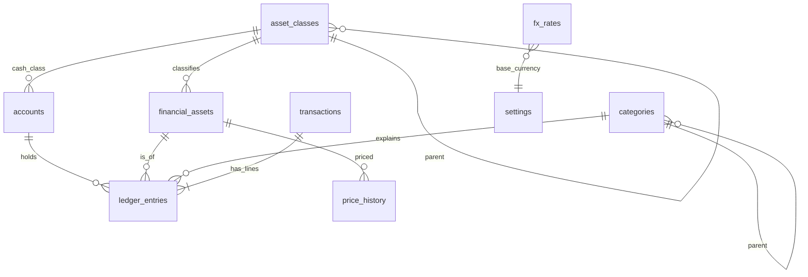

# Data Model (as built)

Verified against the migrations in `lightning/database/migrations/` (68 files, `0001`–`0068`), not only code.
Tables referenced here are those created by `CREATE TABLE` in those scripts (63 found). Column-level detail for
the core tables below was read from `0001_initial.sql`; later migrations extend some (for example `0013` adds the
`REVALUATION` effect), so treat the migration files as the final word.

## 1. Technology and conventions

- SQLite; SQLCipher when the profile is encrypted (`database/connection.py`). One connection per thread, explicit transactions, nested calls become savepoints. An encrypted database must stay on its owning thread.
- Ids: internal integers; people see `code` (master data) and `ref` (documents).
- Dates: `TEXT` `yyyy-mm-dd` (enforced by `GLOB` CHECK). Timestamps: ISO-8601 text with offset.
- Money/quantity/price: `INTEGER` scaled by 1,000,000 (suffix `_e6`) so `SUM()` is exact. Overflow beyond signed 64-bit is refused.
- Booleans: `INTEGER` 0/1 with `CHECK`.
- Migrations are append-only; never edit an applied one. A pre-upgrade verified backup is written before pending migrations.

## 2. Core ledger (ER)

### Data dictionary (core)

| Table | Purpose | Key columns and rules |
|---|---|---|
| `settings` | Profile key/value (base currency, preferences) | `key` PK; `value` NOT NULL. Base currency can change only before ledger/FX history exists. |
| `asset_classes` | Editable tree of *what* wealth is (Liquid Cash › Bank Balance …) | `code` UNIQUE; `parent_id` self-FK; `active`. |
| `financial_assets` | A specific thing you own a quantity of (EGP cash, COMI, 21K gold grams) | `code` UNIQUE; `currency` 3 chars; `quantity_decimals` 0–6; `is_cash`; `exposure` ∈ CASH, EQUITY, GOLD, FIXED_INCOME, REAL_ESTATE, OTHER; `liquidity` ∈ IMMEDIATE, DAYS, LOCKED; `price_source` ∈ YAHOO, GOLD_CALC, GOLD_LOCAL, MANUAL, NONE (as created; later migrations may widen). One cash asset per currency (partial unique index). |
| `accounts` | *Where* value is held | `account_type` ∈ CASH, BANK, DEPOSIT, BROKERAGE, PHYSICAL_ASSET, RECEIVABLE, OTHER_ASSET, CREDIT_CARD, LOAN, PAYABLE; one `currency`; `last4` must be 4 digits; `opening_date` is not a date boundary for transactions. |
| `categories` | *Why* money moved (tree) | `movement` ∈ INFLOW, OUTFLOW; `scope` PERSONAL/WORK; `income_class` HOUSEHOLD/INVESTMENT; `is_system`; used ones are archived, never deleted. |
| `transactions` | The document the user sees (one transfer = one row) | `ref` UNIQUE; `type` ∈ OPN, IN, OUT, TRF, CNV, BUY, SEL, DIV, VAL, ADJ; `status` ∈ DRAFT, POSTED, VOID; `source` ∈ MANUAL, IMPORT, MARKET_DATA, SYSTEM; `search_text`. |
| `ledger_entries` | The effect: every balance and report derives from these lines | `transaction_id` FK **ON DELETE CASCADE**; `UNIQUE(transaction_id, line_no)`; `quantity_e6`, `unit_price_e6`, `amount_e6` (native), `fx_rate_e6`, `amount_base_e6` (profile currency, dated); `effect` ∈ INFLOW, OUTFLOW, INTERNAL, OPENING (+ REVALUATION from 0013); **CHECK: INFLOW/OUTFLOW lines must have a category.** |
| `price_history` | Dated prices per asset | `price_e6 >= 0`; unique per asset/date/source. Typed (MANUAL) beats fetched. |
| `fx_rates` | Dated rates | `base` = foreign, `quote` = profile currency; `rate_e6 > 0`; `UNIQUE(date, base, quote, source)`. Precedence on one day: MANUAL > TRADE > MARKET > ONLINE. |
| `audit_log` | Before/after record of edits and voids; also one-time form tokens (entity `form`) | `entity`, `entity_id`, `action`, `before_json`, `after_json`. |

Indexes: ledger by (account,date), (asset,date), (category,date), transaction; transactions by date and (type,date) and status. Migration 0068 dropped indexes made redundant by unique constraints.

## 3. Other tables by domain

| Domain | Tables (migration) | What they hold |
|---|---|---|
| Identity and setup | `profile_identity` (0045), `registered_currencies`, `currency_suggestions` (0049), `institutions` (0063) | Profile id; allowed currencies; the profile's own banks/brokers (bundled list lives in `institutions.csv`). |
| People and names | `counterparties`, `counterparty_aliases` (0008), `money_from_others` (0011), `investment_custody_events` | Canonical names, aliases, money/units held for others. |
| Import | `bank_import_batches`, `bank_import_rows`, `bank_import_column_maps` (0008+) | Staged CSV rows awaiting review; nothing posts unreviewed. |
| Budget and reserves | `budgets` (0005), `budget_carryover`, `budget_carryover_resets` (0021), `cash_reserves` (0017), `reserve_allocation_history`, `reserve_transaction_links`, `cash_funding` (0062) | Spending limits and carry-over; money set aside. |
| Cash planning | `planned_items`, `planned_payments` (0034), `loan_extra_payments`, `installment_purchases` (0055) | Recurring bills/income, loans, instalments. Plans move no money; payment links to an ordinary transaction. |
| Certificates and circles | `cd_terms` (0038), `cd_certificates` (0039), `cd_redemptions`, `cd_interest_receipt_*`, `gameya_terms` (0053) | Terms and projections; interest is an estimate. |
| Investments | `investment_targets` (0027), `investment_liquidation_factors`, `investment_dividend_assets`, `other_asset_valuations` | Planner targets, sale factors, dividend mapping. |
| Valuation | `reevaluation_periods`, `reevaluation_entries`, `reevaluation_account_posts`, `reevaluation_suppressed_accounts` (0013) | Month-end checkpoints that post a zero-quantity `VAL` journal, one per account. |
| Physical items | `physical_items` (0022), `physical_item_trade_details`, `physical_item_valuations` | Gold pieces (weight, karat, cost). |
| Rules | `rules`, `rule_conditions`, `rule_actions` (0048) | Auto-categorisation; preview and apply-to-past with one undo. |
| Reimbursements | `reimbursement_claims`, `reimbursement_receipts` (0059) | Claims linked from ledger lines (`ledger_entries.claim_id`). |
| Views and checks | `saved_views` (0058), `reconciled_through` (0056), `zakat_settings` (0054) | Saved filters; per-account "checked against the bank through date D" marker; zakat settings. |

Detailed per-column definitions for these: read the named migration. `Pending Clarification` (D-004): a full column-level dictionary was not generated for all 63 tables.

## 4. Relationships and cascades

- A transaction has ≥1 ledger lines; deleting a transaction cascades to its lines (recoverable flows void instead; see audit).
- Categories, accounts and assets are never hard-deleted once used: they are archived (`active=0`). `Database.referenced` asks every foreign key before delete-or-archive.
- Valuation journals (`VAL`) link a reevaluation period 1:1 per account to a system journal in the main ledger.

## 5. Integrity and validation

**Database triggers** (`0056_checked_history.sql`): once an account is checked against the bank through a date, `checked_ledger_insert` / `checked_ledger_update` abort any ledger change on or before that date ("This month was checked against the bank. Unlock it first.").

`TransactionService` re-checks each line inside the write: cash exactly when the asset is cash; cash only in an account of its currency; profile-currency cash at rate 1; foreign cash needs a saved rate on or before its date; manual entries may not take a wallet or bank below zero; `validate_posting` balances internal lines (base amounts net to zero). `integrity.py` and `transactions/history_check.py` replay history to find breaks.

## 6. Lifecycle and ownership

| Event | What happens |
|---|---|
| First run | Seed (asset classes, categories, cash assets) after migration. |
| Daily/unlock | Encrypted backup (≤1/day, kept 30 by default), integrity-verified. |
| Restore | Private candidate migrated, hash manifest, promotion steps P0–P5 under the instance lock. |
| Start fresh | Never deletes; locks profile or renames old file `*_before-fresh_*.db`. |

Only `TransactionService` writes postings. Other modules build validated postings and ask it.

## 7. Weaknesses

See GAP-006 to GAP-008: migration-0001 CHECK lists are widened later so no single file shows the truth; no generated schema doc existed before this page; `ledger_entries.claim_id` was a bare integer in `0001` (`0006` and `0059` touch it; whether a foreign key now exists was not verified).
