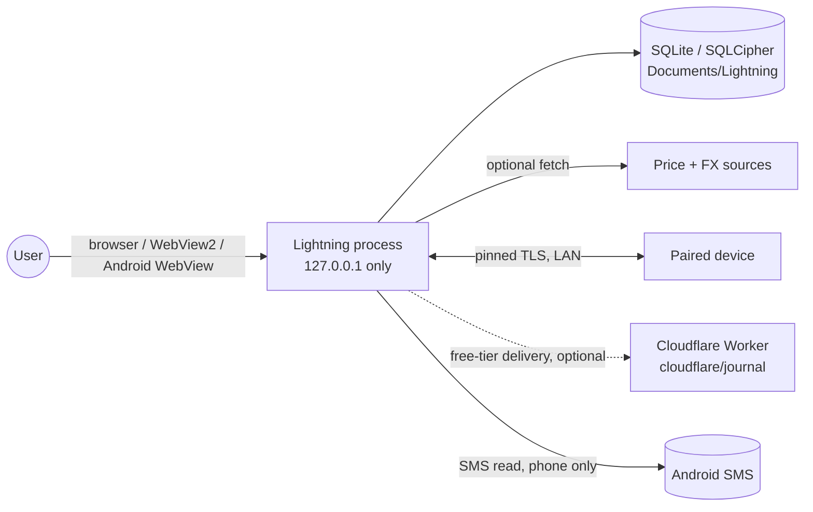
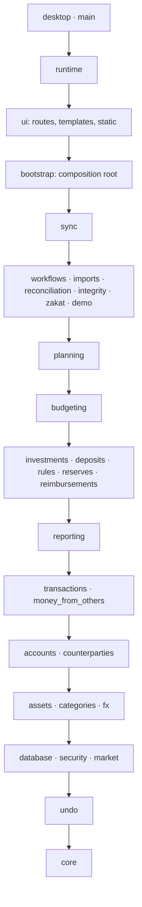

# Software Design (as built)

Detailed contracts: [`docs/ARCHITECTURE.md`](../../ARCHITECTURE.md). This page is the map.

## 1. Overview and principles

Lightning is a **local-first, single-user modular monolith**: one Python process, one SQLite
(SQLCipher when encrypted) file, server-rendered HTML. Principles (Architecture, intro and §Three layers):

1. Correctness first; clear data ownership; new asset types without duplicating transaction logic.
2. **Three layers of truth:** *Ledger* (real money), *Plan* (what-if, moves nothing), *Report* (computed on read, stores nothing).
3. One name, one formula, one function per figure (`lightning/core/figures.py`).
4. Routes and templates never calculate; services do.
5. Money is `Decimal` in Python and scaled integers (`_e6`) in SQLite; never floats.

## 2. System context



## 3. Containers and runtimes

| Runtime | Entry | Notes |
|---|---|---|
| Windows | `desktop_app.py` → `lightning/desktop/` | Thin pywebview + WebView2 window around the same app; PyInstaller one-folder ZIP (`packaging/desktop-app.spec`). |
| Android | `android/` (Gradle), `packaging/phone_build.py` | Embeds Python; Java bridges for SMS (`SmsBridge`) and fingerprint (`BiometricBridge`). |
| Linux / dev | `python -m lightning --profiles` | Same runtime in a browser. |
| Legacy | `python -m lightning` (`lightning/main.py`) | Plaintext `data/lightning.db`, port 8765; `--demo` (8766), `--sample`. |

## 4. Layering (enforced)

`pyproject.toml` `[tool.importlinter]` declares layers; `tests/test_architecture.py` runs `lint-imports` and fails if a top-level module is missing from the contract.



A layer may import only layers **below** it. `lightning/bootstrap.py` is the only place that wires services into a `Container`.

## 5. Components

| Package | Responsibility |
|---|---|
| `core` | Money/date parsing, refs, errors, posting rules (`ledger.py`), figure registry (`figures.py`), request cache (`memo.py`). |
| `database` | Connection (one per thread, explicit transactions, savepoints), migrations (68), seed, backups, audit log, settings, restore promotion. |
| `transactions` | **Sole writer of postings**; edit, void, search, tags, conversion. |
| `accounts`, `assets`, `categories`, `counterparties`, `fx` | Master data and lookups. |
| `investments`, `deposits`, `physical_items`, `reevaluations`, `money_from_others` | Instruments and valuation. |
| `budgeting`, `reserves`, `planning` | The plan layer; `planning/position.py` computes every position figure once. |
| `reporting`, `integrity` | Read-only derived views and data checks. |
| `workflows` | Atomic cross-module use cases (account setup, investment entry, review inbox, exports, price fetch). |
| `rules` | Pure rule engine plus a service that previews/applies rules with one undo. |
| `market` | Price packs: format, registry, delta download, import. |
| `security` | Keys (Argon2id + AES-GCM key wrapping), fingerprint slot, cosmetic license/parts. |
| `sync` | Device protocol v1 (frozen) and the v2 **edit journal** (`sync/journal/`). |
| `runtime` | Profiles, session lifecycle, roles, HTTP guards, launcher, restore. |
| `ui` | FastAPI routes (`ui/routes/*`), Jinja templates, static, i18n, themes. Chart/phrase helpers only draw; they never compute figures. |

## 6. Request lifecycle

```mermaid
sequenceDiagram
  participant B as Browser
  participant G as SessionGate (runtime/app.py)
  participant R as Route (ui/routes)
  participant S as Service
  participant D as Database
  B->>G: POST /transactions ... + __session token
  G->>G: serialise request; check token == current profile generation
  G->>R: dispatch (csrf/size limits checked)
  R->>S: call public service
  S->>D: with db.transaction(): write postings + audit
  D-->>S: commit / rollback
  S-->>R: result or financial error
  R-->>B: redirect or HTML (error shown in plain words)
```

`SessionGate` serialises whole requests against lifecycle changes (lock, switch, shutdown) so a stale tab can never write into another profile.

## 7. Startup and lifecycle

1. Bind `127.0.0.1` socket, take the instance lock, then touch the database.
2. Unlock profile (`runtime/session.py`): password → data key → open SQLCipher on the owning thread.
3. Verified pre-upgrade backup if migrations are pending → migrate → seed → daily backup → due valuation checkpoints → price packs (not on read-only copies).
4. Serve. Idle lock after 15 minutes. Lock/switch/shutdown: stop new work, drain, close, wipe keys, release lock last.

## 8. Error handling, logging, configuration

- **Errors:** typed financial errors (`core/errors.py`) become plain-language messages; writes roll back atomically; 64-bit overflow is checked on every `to_e6`.
- **Logging:** minimal. Only 3 `logging` uses exist in `lightning/`; observability is mostly the `audit_log` table and UI status (see GAP-012).
- **Configuration:** CLI flags (`lightning/main.py`), per-profile `settings` table, `profile_identity`; no environment-variable config layer was found (Unknown for packaging scripts).

## 9. Deployment

CI: `.github/workflows/` — `pr-checks.yml` (Linux tests, ruff, lint-imports; pinned hashed locks), `codeql.yml`, `android-app.yml`, `desktop-probe.yml`, `market-data.yml`, `journal-local-build.yml`, release publishing workflows. Pushes run Linux only; Windows/Android workflows are run by hand to save CI minutes (AGENTS.md §2).

## 10. Security architecture (summary)

Loopback-only bind; session-token on every write; form size limits; SQLCipher with a random 32-byte data key wrapped by password and by recovery key+answer; attempt throttling (5 free, then 1/5/15/60 min waits); optional Android fingerprint wrapping; pinned-certificate TLS 1.3 and signed v2 proposals between devices. Known caveat: freed memory is not wiped (owner decision, 2026-10-03). Full threat model: Architecture › Encryption.

## 11. Known weaknesses

Collected with evidence in [GAP_ANALYSIS](../analysis/GAP_ANALYSIS.md): stale version stamps in references, sparse logging, unsigned Windows build, large single files (`ui/` ≈ 18.5k lines, `sync/` ≈ 11k).
