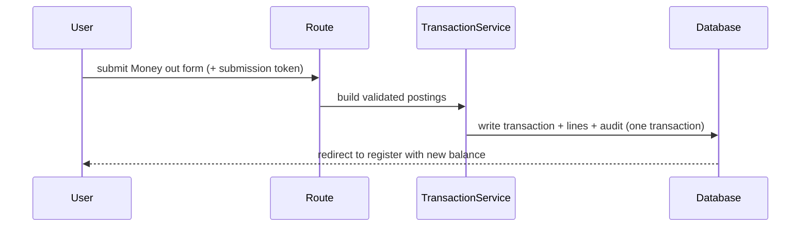
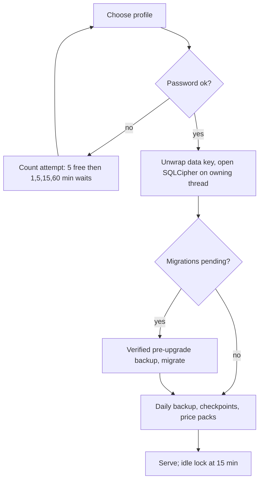

# Workflows (as built)

## WF-1 Record a payment

**Goal:** real money moves; balances and reports update. **Actors:** user. **Pre:** profile unlocked, account exists.

Alternatives: transfer (`TRF`), conversion (`CNV`, executed rate, optional fee), investment buy/sell/dividend (`workflows/investment_entry.py`). **Failures:** below-zero cash, missing FX rate, overflow, duplicate submit → refusal in plain words; nothing saved; a resend returns the first save.

## WF-2 Import a bank file

1. Upload CSV for an account (`/accounts/{id}/import`), map columns (`.../import/map`).
2. Rows are staged; rules and counterparty matching suggest categories; duplicates detected.
3. User reviews the batch (`.../import/{batch_id}`); only then rows post through `TransactionService`.
4. An import can be undone as a batch (`/import/{batch_id}/undo` in workbench).

SMS (phone): parser reads CIB/NBE-style messages, unknown wording is flagged *Check this*, staged into the same review. Nothing posts unreviewed.

## WF-3 Month-end valuation

On unlock/start, due checkpoints value holdings at the latest price/rate and post only the **change** as a zero-quantity `VAL` journal. A missing price or rate stays pending in *Needs you*.

## WF-4 Plan versus real money

Budget limit → plan only. Reserve → lowers Free cash. Scheduled bill → counted in *What you owe*. "Record and mark paid" posts an ordinary transaction and links the plan item to it.

## WF-5 Unlock, lock, switch

Forgot password: recovery key **and** security-question answer set a new one. Losing the password and one other secret loses the data.

## WF-6 Edit on two devices (edit journal)

Phone is *home*; other devices pair (discover nearby home → pick matching number from three → enter password → home confirms). Edits become signed proposals; the home confirms in order; non-home devices show pending overlays and "Not taken" refusals. Cloud relay (free tier) is optional. Details: Architecture › Edit journal; plan `issues/4-edit-journal-and-devices/`.

## WF-7 Restore a backup

Choose a backup of the same named profile → password → private candidate migrated → hash manifest → promotion P0–P5 under lock. If uncertain state, the profile will not open for writes until repaired. Status: restore-safety hardening still claimed in `NOW.md` (03a).
