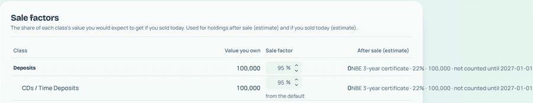
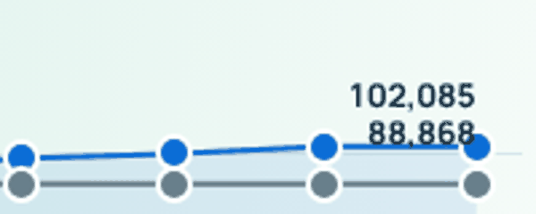
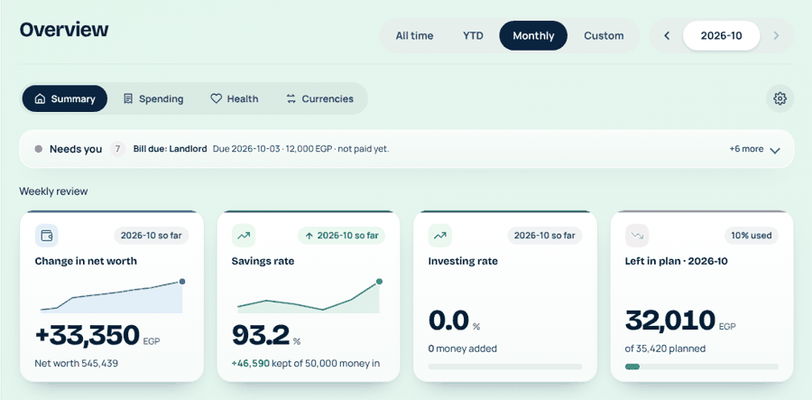
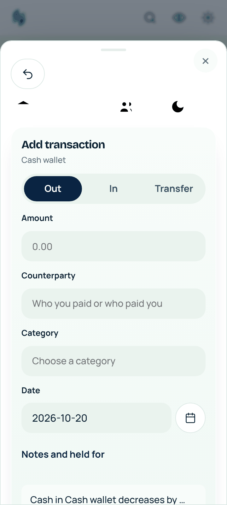
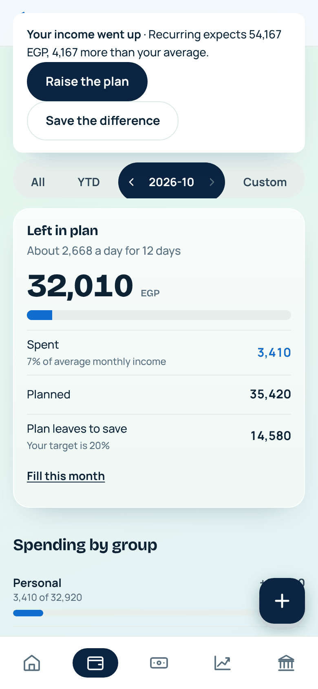
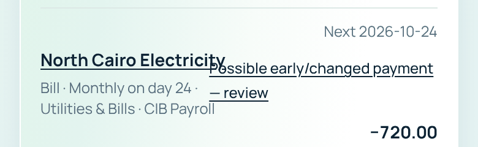
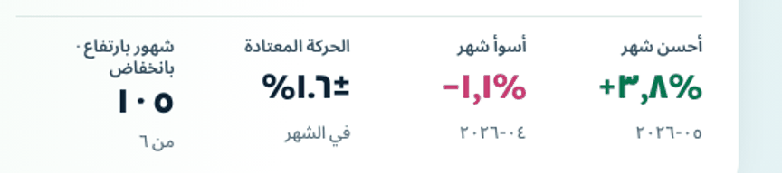
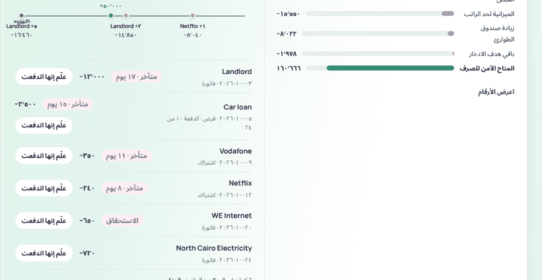

# Audit 1: is Lightning ready to demo?

2026-10-20 · Claude · app 1.3.0, commit `7591231` (main) · Mohab's 2026 sample and the demo household, prices offline.

The owner asked for a tight app to demo, not more features: (1) the engine works with no bugs, (2) the logic links the sections and suggests
things (such as tracking a bill) without redundancy or pain points, (3) the screens follow the guideline with fitting, working visuals, and the phone
and Arabic checked alongside. Five audits ran in parallel, one per part. Every finding below was reproduced, and most high ones were rechecked in the
code or in a screenshot before filing. Each finding is now an item in [the plan](../issues/INDEX.md); this report is the summary and the evidence.

## Verdict

| Part | Verdict | Must fix before a demo |
|---|---|---|
| 1 Engine | **The math holds.** Every figure reconciled on both datasets, every write moved every tab by exactly its amount, and the full suite passes (2,112 tests, 0 failures). The faults are in what bad input gets through. | [2E](../issues/2-safe-for-real-money/2E-engine-input-checks.md) 1–5 |
| 2 Logic | **The smart parts exist and mostly work, but three of them break trust and the rest are hidden.** Bill matching misses cross-account payments and offers last month's payment. Early salary counts twice. A false "your income went up" is the first nudge. | [7K](../issues/7-planning-import-and-search/7K-payment-matching-trust.md), [7L1](../issues/7-planning-import-and-search/7L-needs-you-as-the-smart-inbox.md), [3V](../issues/3-polish-and-arabic/3V-demo-data-shows-the-smart-features.md) |
| 3 PC visuals | **Close to the guideline.** The brand audit passes, there are no JavaScript errors and every control works. One page scrolls sideways, and a few charts mislead. | [3S](../issues/3-polish-and-arabic/3S-pc-guideline-breaks-audit-1.md) 1–5, [3C](../issues/3-polish-and-arabic/3C-chart-end-labels-overlap.md), [3A](../issues/3-polish-and-arabic/3A-rate-decimals-and-arabic-order.md) |
| Phone | **Usable, with three visible bugs in the first minute.** Every sheet shows a copy of the page's undo pill and tabs. Save does nothing without a category. The raise prompt covers the top bar. On Android, backup and import do nothing. | [3R](../issues/3-polish-and-arabic/3R-sheets-silent-save-and-prompt-over-top-bar.md), [2F](../issues/2-safe-for-real-money/2F-android-downloads-files-links.md) |
| Arabic | **Nearly all translated and mirrored, but numbers can read wrong.** The "·" beside a number looks like the Arabic zero, so "Late 17 days" reads as 170. Decimals mix "." and ",". About ten strings are still English, one of them on every page. | [3U](../issues/3-polish-and-arabic/3U-arabic-dot-reads-as-zero.md) 1–3 |

**In one line:** the engine can be shown today. What a viewer sees first can't yet: the demo data raises false alarms, the smart features sit two
or three clicks down, and the phone has three bugs. The cut list below fixes those first.

## Demo cut list, in order

Must fix (each is small and is seen in the first minutes):

1. **[3V](../issues/3-polish-and-arabic/3V-demo-data-shows-the-smart-features.md) Demo data.** The demo certificate's rate is set to 18%, but its payouts are 22%. As a result the demo's only Needs-you item can never be matched. The sample shows four late bills when opened today. The demo has nothing for Looks recurring to find.
2. **[7L1](../issues/7-planning-import-and-search/7L-needs-you-as-the-smart-inbox.md) False raise prompt.** The yearly bonus is spread over 12 months and read as a raise.
3. **[3R](../issues/3-polish-and-arabic/3R-sheets-silent-save-and-prompt-over-top-bar.md) Phone.** Sheets copy the page chrome, Save fails silently, the prompt covers the top bar, and the tab bar sits above the keyboard.
4. **[7K](../issues/7-planning-import-and-search/7K-payment-matching-trust.md) Bill matching.** Fix payments made from another account, last month's payment offered for this month, and early salary counted twice.
5. **[2E](../issues/2-safe-for-real-money/2E-engine-input-checks.md) 1–5 Input checks.** A split can lose a piaster, a gold account accepts expenses, cash can go below zero, and two crashes (500 errors).
6. **On-screen faults:**
   - [3S](../issues/3-polish-and-arabic/3S-pc-guideline-breaks-audit-1.md) 1: Sale factors scrolls sideways.
   - [3C](../issues/3-polish-and-arabic/3C-chart-end-labels-overlap.md) and 3S 2: chart end labels overlap.
   - [3A](../issues/3-polish-and-arabic/3A-rate-decimals-and-arabic-order.md): "51.600000" rate.
   - [5H](../issues/5-investments/5H-sample-reconciliation-difference.md): +1,394 "unresolved". The cause is now found: the revaluation of USD cash.
7. **[3U](../issues/3-polish-and-arabic/3U-arabic-dot-reads-as-zero.md) Arabic.** Change the separator that reads as a zero, use one decimal style, and translate the English undo label shown on every page.
8. **[2F](../issues/2-safe-for-real-money/2F-android-downloads-files-links.md) Android.** Downloads, file inputs and outside links do nothing. This is needed only if the demo shows backup, export or import on the phone.

Makes the demo shine (wiring of what exists, no new engines):

- **[7L2](../issues/7-planning-import-and-search/7L-needs-you-as-the-smart-inbox.md) Needs you as the one smart inbox.** It would carry Looks recurring · Track, early payment found · Link, Make a rule, Refill a reserve, and a category over plan.
- **[7L3](../issues/7-planning-import-and-search/7L-needs-you-as-the-smart-inbox.md) Looks recurring finds subscriptions and bills that vary.** Today it misses Shahid and electricity.
- **[5K](../issues/5-investments/5K-certificate-holding-page.md) The certificate's page.** It shows interest, not price charts.
- **3S 3–5 and [3T](../issues/3-polish-and-arabic/3T-phone-guideline-breaks-audit-1.md) 1–3.** Charts that mislead, cut words on the phone, and pages with no way back.

Polish after the demo: the rest of 3S and 3T, and the five pages left in [3Q](../issues/3-polish-and-arabic/3Q-visual-audit-cards-that-compare.md).

## 1 Engine: does the money math hold?

**Checked and fine, on both datasets:**

- **Crawler:** 600 pages each. Only 3A turned up.
- **Ledger:** every transfer sums to 0, base = amount × rate, and no cash line has less than a piaster.
- **Balances:** sidebar = Accounts = sum of rows = ledger (264,481 demo; 602,179 sample), and Held for others matches.
- **Overview:** What you own, Net worth, Change in net worth, savings and investing rates, and the net-worth chart for all 10 sample months all match.
- **Money out:** Overview, Spending and Budget show the same figure for October, September and the year (sample 293,274 / 577,860).
- **Budget:** planned − spent = left, per category and in total.
- **Cash planning:** Safe to spend = sum of its parts (41,953; 160,666), also on 10-31, 11-01, 11-02, 12-31 and 2027-01-01.
- **Health:** every ratio recomputes from the figures printed beside it.
- **Investments:** cost, value and gain equal the sum of holdings.
- **Zakat:** 580,439 × 2.5% = 14,511.
- **Loans:** the balances are right.
- **Reserves:** the top-up formula is right.
- **Writes:** each of these, then void, delete or restore it, moved every tab by exactly the amount and back:
  - an expense, income across a month edge, a transfer and its edit;
  - a bill payment (a double submit is refused);
  - buy and sell (oversell is refused), a conversion, a USD expense;
  - a budget limit, a reserve, held for others;
  - a reconcile, a gold revaluation, a bulk delete.
- **Floats:** no float touches money.
- **Main forms:** they refuse blank, zero, negative, letters, 1e12, NaN, 3+ decimals, bad dates and wrong account types.

**Found:**

| Severity | Finding | Item |
|---|---|---|
| High | Splitting 1,000 as 333.334 + 333.333 + 333.333 is accepted. The account's EGP balance and its own balance then differ by 0.01. | 2E 1 |
| Medium | Money in or out is accepted on a gold account. The register offers it, and negative cash is left inside the gold account. | 2E 2 |
| Medium | Cash goes below zero, even through money held for others: CIB ends at −58,672 while Mom's 10,000 is still listed, and every data check passes. | 2E 3 |
| Medium | A 500 error on an unknown owner, and another on Planner amount 0. | 2E 4–5 |
| Medium | Converting EGP to USD raises net worth by 875: the trade rate revalues every USD holding. | [5J](../issues/5-investments/5J-conversion-raises-net-worth.md) |
| Medium | Paying a loan early empties the everyday budget, but Safe to spend moves only 21. | [7M](../issues/7-planning-import-and-search/7M-early-loan-payment-and-reserve-spending-in-budget.md) |
| Medium | Demo certificate: 18% set, 22% paid. Sample: late bills shown on today's date. | 3V |
| Low | Dates before an account opened are accepted. Crafted posts can still cause 500 errors. | 2E 6 |
| Low | Displayed parts don't add up after rounding (130,586 against 130,585). | 2E 7 |
| Low | Each investment post creates void revaluation entries (456 after a fuzz run). | 2E 8 |
| Filed | The +1,394 reconciliation difference is the FX revaluation of USD brokerage cash (`ui/routes/investments.py:109-113`). | 5H, now *ready* |

Not checked: online prices, Gam'eya writes (no circle in either dataset, 5I), CSV/SMS amounts (7H), Windows profiles mode.

## 2 Logic: do the sections link, and does it suggest things?

**What exists and works:**

- **Looks recurring → Track:** works end to end. The tracked item appears in Recurring, the next 30 days, the forecast and Budget, and the next real payment settles it with no double count.
- **Changed bill amount:** "You paid 760 instead of 720", with an offer to update.
- **Category from the name:** filled in when the field is left empty.
- **Rule offers:** made after four corrections.
- **Import:** offers to link a bank row to an entry already recorded (±3 days) and settles bills.
- **Certificate interest:** Match all matched 8 of 9 in one press on the sample.
- **Budget nudges:** Move 3,551 from Entertainment; planned below its bills.
- **Expenses and reserves:** suggests a reserve for a large expense.
- **Loans:** an instalment reduces the loan without moving net worth.

**What breaks trust:**

| Severity | Finding | Item |
|---|---|---|
| High | A bill paid from another account never links. It stays "Late", Free cash takes it off twice, and the only ways out are recording it again or Skip. | 7K 1 |
| High | The pay popup offers last month's payment for this month: the 09-03 rent for the 10-03 rent. Every newly tracked item shows "Possible early payment" at once. | 7K 2 |
| High | Salary paid 12 days early: Safe to spend jumps by 45,000 and November still counts it. Nothing in Needs you. | 7K 3 |
| Medium | "Your income went up · 54,167" is false: 50,000 salary plus a yearly 50,000 bonus ÷ 12. It is the first nudge on the sample's Overview and on Budget. | 7L1 |
| Medium | Looks recurring misses Shahid (99 a month for six months, because it's filed under Entertainment) and any bill varying more than 20% (electricity). Track always proposes a Bill. | 7L3 |
| Medium | Expenses linked to a reserve still count as overspending on Budget. Needs owner decision. | 7M 2 |

**What is hidden (the main pain point):**

- Looks recurring sits at the bottom of Recurring.
- Rule offers appear only on Weekly review.
- Payday funding and reimbursements open only from Weekly review.
- Needs you, the one inbox, carries none of these. Neither does it show a category over plan this month, or Health's own "Needs you" bands: the emergency fund at 0.8 months is flagged on Health and missing from the list.
- The fix is wiring: [7L2](../issues/7-planning-import-and-search/7L-needs-you-as-the-smart-inbox.md).

**Redundancy, already filed and still open in [3G](../issues/3-polish-and-arabic/3G-one-organism-review-of-every-tab.md) and [3H](../issues/3-polish-and-arabic/3H-tab-by-tab-review.md):**

- **Two pages for one transaction:** `/transactions/<id>` and `/activity/<id>`, under different tab bars.
- **One word, two values:**
  - "Bills due" is 15,740 in Free cash and 13,240 in What you owe.
  - Plan shows "Due before payday 720 · 15,090 already late".
- **Two names for one figure:** Total balance = In your accounts; Cash available to assign = Free cash; Portfolio value = Holdings value.
- **Weekly review repeats Needs you.**
- **Pages without a home tab:** `/activity`, `/review`, `/reimbursements` and `/payday`.
- **3G/3H already built:** 3G §3.4 items 1–10 (the raise prompt fires falsely), Budget until payday, Budget's bill list with Mark paid, and 3H CP-1, CP-8, CP-10, CP-11, FR-2, LO-2, LO-3, X-14.
- **3G/3H still open:**
  - 3G: three hero numbers, one Bills due figure, one home per page, a counterparty page, what-if.
  - 3H: CP-6 can I afford it, CP-7, CP-9, RS-2, RS-3, BU-10, OV-3.

## 3 PC: guideline and visuals

**Automatic:**

- `tests/test_brand_audit.py` and `tests/test_docs_structure.py` pass.
- No JavaScript errors and no failed requests on about 60 pages, at either width, in either dataset.
- Every period button, month stepper, Ctrl-K, Hide amounts, pop-up, tab, filter and register menu worked.

**Checked and fine:**

- **Overview:** waterfall, Sankeys, donut (four then Other), calendar.
- **Spending:** treemap, usual-range dots.
- **Health:** meters.
- **Budget:** the new KPI row.
- **Cash planning:** forecast from zero, the lowest point on the low.
- **Recurring:** ranked bars.
- **Accounts and register.**
- **Everywhere:** headers are Ink, there are no capitals, and fields are soft wells.

**Found** (all in [3S](../issues/3-polish-and-arabic/3S-pc-guideline-breaks-audit-1.md) unless named):

- **High:**
  - Settings › Sale factors runs out of its card, so the page scrolls sideways at 1366.
- **Charts that mislead:**
  - End labels are drawn on top of each other (holding Value against cost, the demo's Budget pace chart).
  - Health trends have no axis and don't start at zero.
  - Currencies "USD" plots cash only, so it falls by 88,000 when the ETF is bought.
  - The average-cost line is Meadow.
  - The certificate's page shows price volatility, nine empty "Units out" rows and no interest ([5K](../issues/5-investments/5K-certificate-holding-page.md)).
- **Colour off meaning (A03):**
  - The Overview "Left in plan" meter is Meadow.
  - Category direction colours are off A03.
  - The first run's Azure "Load" link.
  - Gam'eya late instalments show in grey.
- **A16:**
  - Five or more names (Biggest holdings, the Planner).
  - "Personal › Entertainment".
  - Card in a card (Settings › Budget, Spending's small multiples, Certificates' nine fieldsets).
  - Dropdowns for your own accounts (Certificates).
  - Cards alone in their row.
- **Controls and words:**
  - The period control reads "Monthly", and its stepper is a separate pill.
  - The line under page titles is a slogan instead of the dates.
  - Certificates has ten Primary buttons.
  - Counterparties' buttons cover a field.
  - The first Escape in Ctrl-K only clears the search.

**Already filed, still present:**

- 3A: "1 USD = 51.600000 EGP".
- 3C: "12,7G6".
- 3Q: Overview, Spending, Recurring, Loans and Reserves are not done.
- Several 3G and 3H lines: X-12, CP-4, CD-3, PR-1, PR-4, HL-2, IN-6, X-13, OV-7.

## 4 Phone (Part C)

This ran in the real phone frame that Android loads (`profile_app(phone=True)`), at 390 and 360 px with touch.

**Automatic:**

- `tools/phone_check.py` reports nothing scrolling sideways. However, `.phone-content` hides overflow, so cut-off items pass unseen ([3T](../issues/3-polish-and-arabic/3T-phone-guideline-breaks-audit-1.md) asks the check to report them).
- The phone tests pass (46).
- No JavaScript errors except the silent Save.

**Core jobs at 360 px:**

| Job | Taps | Works? | Friction |
|---|---|---|---|
| Add an expense | 8 + typing | Yes, if a category is picked | Save fails silently without a category (3R 2). The learned category is not filled in, and Save is below the fold. |
| Pay a bill | 3 | Yes | The sheet first offers last month's payment (7K 2). |
| Check safe to spend | 1 | Yes | None. |
| See a budget category | 2–3 | Yes | The raise prompt covers the top (3R 3), and the drill-down loses Budget (3T 3–4). |
| Find a transaction | 4 + typing | Yes | Results aren't live, and the page says "Press Ctrl K" (3T 5). |

**Found:**

- **High ([3R](../issues/3-polish-and-arabic/3R-sheets-silent-save-and-prompt-over-top-bar.md)):**
  - Every sheet shows a copy of the page's undo pill and broken tabs.
  - Save does nothing without a category. The same code runs on PC.
  - The raise prompt is a fixed flash over the top bar, and its buttons vanish after 5 s (same cause as 3D).
  - The tab bar never hides for the keyboard.
- **Medium ([3T](../issues/3-polish-and-arabic/3T-phone-guideline-breaks-audit-1.md)):**
  - Cut words ("0.6 n", "By market", first letters of Plan headings).
  - Overlapping text on Recurring.
  - Five pages with no way back.
  - A full-screen filter card before Budget's transactions.
  - Targets under 48 px.
  - Settings has five tabs.
  - Revaluations shown as "Latest" money.
  - Axes with 8–10 labels.
  - 15 px field text.
- **Android shell ([2F](../issues/2-safe-for-real-money/2F-android-downloads-files-links.md)):**
  - No download listener: Back up, Export and templates do nothing.
  - No file chooser: CSV import does nothing.
  - Outside links are swallowed.
  - Otherwise well locked down: localhost only, no backup, no debugging, insets padded.

**Checked and fine:**

- The app bar and tab bar, with safe areas.
- Section tabs are 48 px tall.
- The add button never covers the page end.
- No capitals, Ink headers, no text under 12 px.
- No dropdowns for your own data.
- Amount fields open the decimal keypad, and date fields open a picker.
- The transaction list follows C08.
- The account header follows C04.7.
- Overview charts follow C07.
- Hide amounts works.

**Already filed, still present:** 3D (any flash device line is still removed after 5 s), 3F (near-white app bar), 5I (no owed breakdown on the phone), 3A.

## 5 Arabic

This part is partial. The Arabic audit agent stopped on the org's spend limit after it crawled every page in Arabic (138 sample pages,
118 demo pages) and took the PC and phone screenshots. Claude read the crawl and the main screenshots. 3A, 3B, 3E and the brand-voice review were
not rechecked.

**Checked and fine:**

- The Arabic tests pass, as part of the full suite.
- Every page is Arabic. The English left is bank and broker names (allowed) and typed names (data), plus the items below.
- Layout is mirrored, not just flipped: sidebar, tabs, chevrons, the back arrow ("› حساباتك"), and bars that grow from the right.
- Arabic-Indic digits are used in visible text.
- Dates read year first in RTL.
- Noto Sans Arabic loads.
- The phone tab bar and sheets are mirrored.

**Found** (all in [3U](../issues/3-polish-and-arabic/3U-arabic-dot-reads-as-zero.md)):

| Severity | Finding |
|---|---|
| High | The "·" beside Arabic-Indic digits looks like "٠": "متأخر · ١٧ يوم" reads "١٧٠" (170 days late), "up · down 5 · 1" reads "١٠٥", and every "date · Bill" subtitle runs together. |
| Medium | One card shows "±١.٦%" and "+٣,٨%". Zakat uses "٢٫٥٪" while the screens use "%". |
| Medium | Still English: the undo button's "Saved changes (Ctrl+Z)" on every page, the "Plan this transaction" page, phone Settings' "Setting" and "Where", "1 entry", a placeholder, the budget move preview, and the raw "MONTH_END". |
| Medium | The Plan timeline's "اليوم" is drawn over "Landlord +٥". Chart axes use a Latin "k". |
| Low | "الدفعة ١٠ من ٢٤" wraps, leaving "٢٤" alone on a line. |

## Owner decisions

1. **[5J](../issues/5-investments/5J-conversion-raises-net-worth.md):** should a currency conversion's rate revalue the other dollar holdings?
2. **[7M](../issues/7-planning-import-and-search/7M-early-loan-payment-and-reserve-spending-in-budget.md):**
   - Does principal paid early count against everyday money?
   - Does an expense covered by a reserve count against its budget category?
3. **Safe to spend as a hero number on the Overview** (3G §9 Q1). It is the figure people ask about, and today it lives one tab down.
4. **Guideline gaps found on PC:**
   - Is the global Needs-you strip exempt from "a key note is never a row"?
   - The EGP/USD lens as a second pill bar.
   - Which tables may pass A11's five columns (register 6, holdings 10)?
   - The month is typed and also opens a popup.
   - A visual for Gam'eya and Zakat.
   - THNDR's six-choice control.
   - A 1,120 px content cap on wide screens.

## How this was run

Run the same audit again with `skills/bug-hunt`, `number-audit`, `guideline-audit` and `arabic-check`:

- `python -m lightning --demo` and `--sample`, each on its own port, prices offline.
- `tools/bug_crawl.py`.
- SQL reconciliation on `data/*.db`.
- Direct POSTs for writes and bad input.
- Playwright at 1366, 1920, 390 and 360 px.
- The phone frame through `profile_app(phone=True)`.
- `tools/phone_check.py`, the brand and Arabic tests.
- The full suite: `python -m pytest -n auto --dist loadfile`.

The screenshots kept here are only the ones that show a must-fix.
